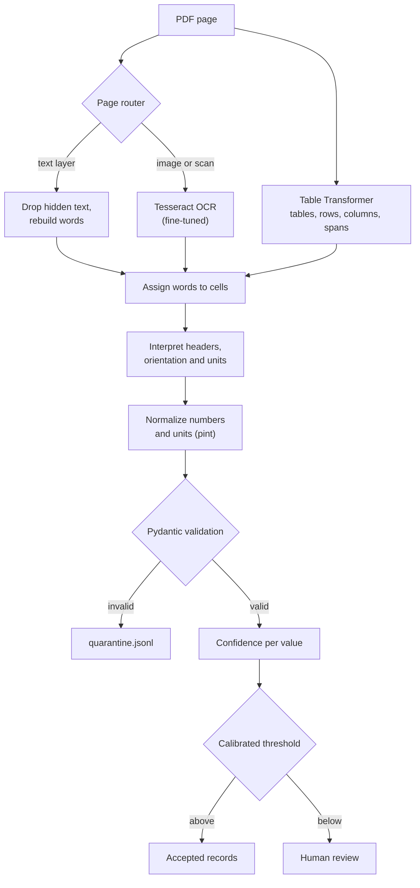
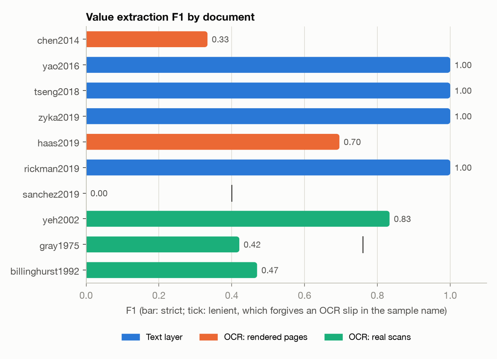
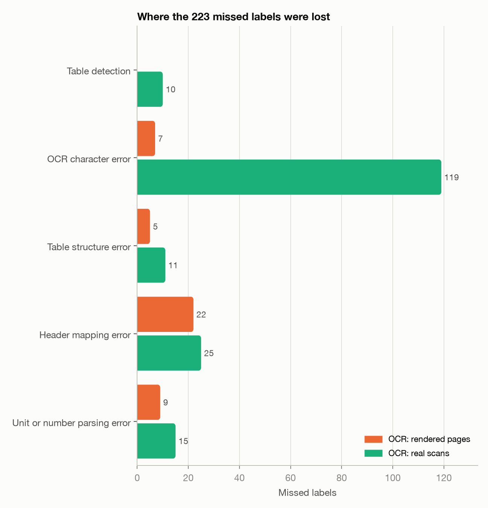
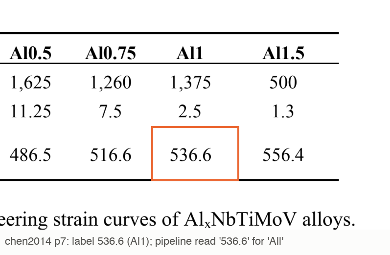
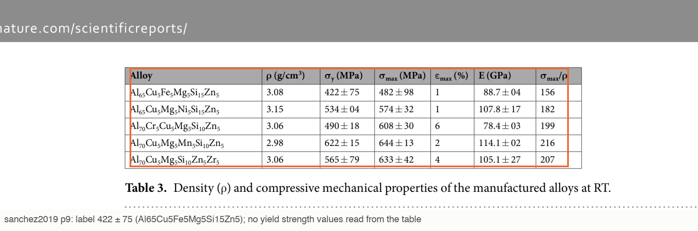
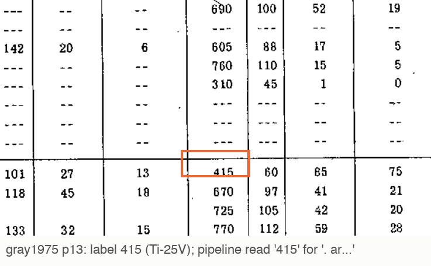
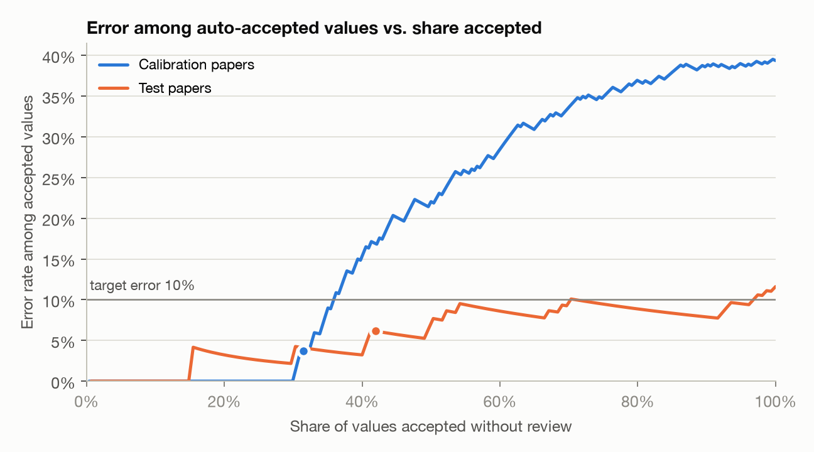

# TableTrace

[](https://github.com/tanaymihani/tabletrace/actions/workflows/ci.yml)

Extracting property tables from scientific PDFs, including scanned ones, with a calibrated
review step.

TableTrace pulls mechanical properties (Vickers hardness, yield strength, ultimate strength and
elongation) out of tables in journal papers, patents and old technical reports. Each value is
stored as a validated record that points back to the exact cell it came from. Each one also gets
a confidence score, and values below a calibrated threshold get sent to a person to check.

Main results:

- On pages with a text layer it gets all 122 labeled values right (F1 1.000). Getting there meant
  finding that four of the five MDPI papers hide a shifted duplicate of their tables in the text
  layer. Reading the raw text layer only gets 0.758.
- On real scans it gets strict F1 0.506. The OCR text that already comes inside those scanned PDFs
  gets 0.265.
- Stock Tesseract can't output `±`, `σ` or `ε` at all, so I fine-tuned it on synthetic table cells.
  Character error on table regions went from 27.9% to 18.8%.
- The review threshold targeted 10% error on auto-accepted values and got 6.2% on the held-out
  papers. When I re-ran the calibration over every way of splitting the papers, it held much less
  often (details below).
- 514 labeled values across 10 documents. 255 of them were checked against an independent source,
  including LitXAlloy (all 102 shared values agree).

## Pipeline



## Results

All 514 labels, final version of the pipeline. "Strict" means the sample name, property and value
(within 1%) all match. "Lenient" also accepts a sample name with a small OCR mistake in it
(similarity of 0.85 or more).

| Split | Labels | Precision | Recall | F1 (strict) | F1 (lenient) |
|---|---|---|---|---|---|
| Text-layer pages | 122 | 1.000 | 1.000 | **1.000** | 1.000 |
| OCR pages | 392 | 0.589 | 0.431 | **0.498** | 0.692 |
| &nbsp;&nbsp;rendered journal pages | 63 | 0.741 | 0.317 | 0.444 | 0.533 |
| &nbsp;&nbsp;real scans (patent, NASA reports) | 329 | 0.573 | 0.453 | 0.506 | 0.716 |
| All | 514 | 0.711 | 0.566 | **0.631** | 0.774 |

I used the four calibration papers for all development. On the six held-out test papers strict F1
is 0.715. I froze the configuration before running on the test papers for the first time, and that
run got 0.499. It turned up three bugs, which I fixed and re-checked on the calibration papers only.
Both runs are in the repo ([first test run and the fixes](reports/results.md#first-test-run-and-post-hoc-fixes)).

By property: Vickers hardness 0.872, yield strength 0.840, ultimate strength 0.506, elongation 0.512.
Most of the hardness values come from the patent and most of the yield values from journal papers.
Ultimate strength and elongation are pulled down by the 1975 typewritten NASA report, which has 97
labels of each.

| Comparison | Result |
|---|---|
| Same 7 journal papers, text layer vs OCR of the rendered pages | F1 1.000 vs 0.396 |
| Real scans, OCR layer that comes in the PDF vs TableTrace OCR | F1 0.265 vs 0.506 |
| Text layer with vs without the hidden-text filter | F1 1.000 vs 0.758 |
| OCR on table regions of the image-only papers, stock vs fine-tuned Tesseract | CER 27.9% vs 18.8% (WER 52.0% vs 29.6%) |
| OCR on whole pages of the same papers, stock vs fine-tuned | CER 7.5% vs 6.8% |
| LitXAlloy values that come from tables, found in the 7 journal papers | 74 of 74 |

It all runs on my laptop CPU (an 8 GB M2). After the OCR cache is built, the ten documents take
about two minutes. The full report with per-document tables is in [reports/results.md](reports/results.md).



## Data

I wanted the three kinds of documents a materials extraction system actually has to deal with:
journal papers, patents and technical reports.

| Document | Source and license | Route | Why it's hard | Labels |
|---|---|---|---|---|
| Chen 2014, Yao 2016, Tseng 2018, Zýka 2019, Haas 2019 | *Entropy* (MDPI), CC BY | text layer, or rendered to images | transposed tables, two-level headers, Rp0.2/Rm/A notation, hardness in MPa, `> 50`, calculated vs measured columns, hidden duplicate text | 163 |
| Rickman 2019, Sanchez 2019 | *Nature Commun.*, *Sci. Rep.*, CC BY | text layer or rendered | captions under the table, ± in every cell, formulas with subscripts | 22 |
| US 2002/0159914 A1 (Yeh) | Google Patents, public domain | real scan | the original high-entropy alloy patent: five hardness tables, units inside cells (`Hv1,049`), tables continued across pages | 59 |
| NASA TM X-3216 (Gray, 1975) | NTRS, public use | real scan | typewritten and stamped "original page is of poor quality", a three-level header, every stress in both MN/m² and ksi, hand corrections | 194 |
| NASA TP-3288 (Billinghurst, 1992) | NTRS, public use | real scan | cryogenic tensile data in ksi and °F, footnote marks, `NA`, printed averages | 76 |

The seven journal papers are the ones in LitXAlloy (the alloy part of Radical AI's LitXBench, 2026)
that report these properties in tables. That means someone else has curated their values too, which
I use to check my labels. I rendered three of them (Chen, Haas, Sanchez) to 300 DPI images and
removed the text layer. That forces OCR, and the original text is still there to measure OCR error
against. The calibration/test split is by document and was set in `papers.csv` before I ran any
extraction.

The PDFs aren't committed. `make data` downloads them from fixed sources (LitXBench at a pinned
commit, NTRS, Google Patents) and checks each file's SHA-256.

The labels are 514 values typed from the page images into [`labels/transcriptions.py`](labels/transcriptions.py)
before any pipeline output existed, then expanded into `labels/ground_truth.csv`. The labeling rules
and checks are in [labels/README.md](labels/README.md). Three checks against independent sources
cover 255 of the values and didn't turn up any labeling mistakes:

- LitXAlloy: all 102 shared values agree, and all 74 LitXAlloy values whose source is a table are in
  my labels.
- NASA TM X-3216 prints every strength twice, in MN/m² and ksi. 96 of the 97 pairs agree. The one
  that doesn't is an inconsistency in the report itself (530 MN/m² printed next to 79 ksi).
- NASA TP-3288 prints group averages. 13 of the 15 recomputed averages match. The other two are
  mistakes in the source, which I confirmed at 450 DPI.

## How it works

1. **Routing.** Pages with a usable text layer take the text route. Pages with no text, and scans
   that come with someone else's OCR layer, take the OCR route. The existing OCR layer is kept as a
   second opinion. All 149 pages in the ten documents get routed correctly.
2. **Finding tables.** Table Transformer detection on a 200 DPI render, for both routes. Captions
   ("Table 3.", "TABLE I. -", or Nature-style captions under the table) are matched to tables by
   position and give the table number.
3. **Reading the text.** On the text route, words are rebuilt from characters after dropping the
   hidden text (see below). Each line keeps its own vertical band, so subscripts stay with their
   line (`Nb1.5TaTiZr0.5`, `Rp0.2`) and a label sitting between two header lines doesn't glue them
   together. On the OCR route, Tesseract reads the whole table in sparse-text mode, then the header
   row and any suspicious cells get read again one at a time, because the whole-table pass loses
   short labels like `500` or `ksi` and some `±` signs.
4. **Recovering the grid.** Table Transformer structure recognition (v1.1) gives rows, columns, the
   header block and spanning cells. When the header has vertical rules, I take the spans from the
   rules instead. Each word goes into the cell that contains its center. If a row has two lines of
   numbers in it, it gets split into two rows.
5. **Interpreting the table.** Finding the header rows and label columns, working out whether the
   table is normal, transposed, or only names the property in its caption, building multi-level
   header paths, pulling test temperatures out of group headers, handling replicate rows, skipping
   calculated or predicted columns, handling Calc/Exp pairs, and merging dual-unit columns (MN/m²
   next to ksi). The ratio between those two columns also recovers units when OCR can't read them.
6. **Normalizing numbers and units.** Formats like `1,234.5`, `1 234,5`, `412 ± 8`, `5–50`,
   `1.2 × 10³`, `> 50`, `*1190` and `Hv1,049`. Units go through pint. I define the Vickers number
   as kgf/mm², so hardness printed in MPa converts correctly.
7. **Mapping headers to properties.** An alias table for the notation in this literature (EN ISO
   Rp0.2/Rm/A, σ and ε symbols, US YS/UTS/EL), with fuzzy matching for headers OCR has damaged.
   Things that look similar but aren't targets (reduction of area, modulus, δ as atomic size
   mismatch) are recognized on purpose so they don't get mapped by accident.
8. **Validation.** Every record goes through a Pydantic model that checks the unit, a physical range
   (elongation over 100% is allowed for high-temperature tests) and that there's a sample name.
   Anything that fails goes to `quarantine.jsonl` with the reason.
9. **Confidence.** Combines Tesseract's confidence for the cell, how well the header matched, range
   checks (including yield strength not being above UTS for the same sample), agreement with the
   second route, and agreement between dual-unit columns.
10. **Review threshold.** A cutoff chosen on the calibration papers decides which values need a
    person to look at them.

## What I found

**Born-digital PDFs can have a text layer that doesn't match what you see.** Four of the five MDPI
papers embed a full page of the author's manuscript as a Form XObject, just to reuse one vector
figure. The PDF viewer clips it to the figure area. pdfminer (and so pdfplumber) and pdfium's text
API ignore the clipping, so the text layer ends up with a second copy of every table on that page,
shifted down by one row. Plain pdfplumber reads `HfNbTaTiZr 1155` as `NHbfTNabTTiZarT 11550 .2`.
Dropping the characters inside embedded figures fixes it completely. That's 9,202 hidden characters
on the labeled pages of three papers. Without that filter, text-layer F1 drops from 1.000 to 0.758.

**Tesseract can't output ±.** The stock English LSTM model doesn't have `±`, `σ`, `ε` or `µ` in its
character set. So "value ± uncertainty" cells come out as `422+75`, `534404` or `1148`, and σ or ε
headers come out as `oy`, `6,` or `©`. On the rendered journal pages, 40 of the 63 labeled values
have a ±.

**Fine-tuning Tesseract took a few tries.** I rendered 10,000 synthetic lines (random alloy formulas
with real subscripts, values with ±, headers, ruled table rows, scan noise) and continued training
tessdata_best/eng on them. None of the content comes from the documents I evaluate on. My first
version was trained only on table content and didn't keep the English dictionary. It read `±`
perfectly but lost normal English ("Alloy" came back as `A10Yy`, "strength" as `5trength`), and F1
on OCR pages went to zero. Adding 30% ordinary prose and keeping the base model's word list fixed
that. I also tried a third version with subscripted, bold header lines. It had lower character error
on the calibration tables but lower extraction F1, so I kept the second one. Better CER doesn't
automatically mean better extraction. The model I kept raises strict F1 on the calibration OCR
documents from 0.251 to 0.399. On the four test OCR documents it's mixed: better on two (Chen 0.09
to 0.33, TP-3288 0.28 to 0.47) and slightly worse on two (Haas 0.80 to 0.70, the patent 0.87 to 0.83).

**The old NASA reports print every stress twice, which works as a checksum.** NASA TM X-3216 gives
each UTS in both MN/m² and ksi. Their ratio (6.895) lets the pipeline figure out the units when OCR
garbles the unit row (`MN/in?`, `KBi`), merge the two columns into one record, and check that they
agree.

**The source documents have mistakes in them.** The same kind of consistency checks found three.
NASA TP-3288 prints averages that its own sample values don't reproduce (108.5 ksi for samples
averaging 108.1, and 17.4% for elongations averaging 10.8%). NASA TM X-3216 prints 530 MN/m² next
to 79 ksi, which is 545 MN/m². And the Yeh patent's Table 7 reuses the alloy numbers from Table 6.
Getting the cell right doesn't help if the source is wrong about the alloy.

**Table Transformer struggles with patents.** It was trained on journal articles (PubTables-1M). At
the detection threshold I fixed using the calibration papers, it missed 3 of the 7 labeled table
blocks in the patent, which is 10 labels. I didn't lower the threshold based on a test document.
Fine-tuning the detector on a few patent pages would probably fix it.

## Error analysis

Every label that wasn't matched strictly, grouped by the stage where it got lost. A quarantined cell
with the right digits counts as a parsing error. The right value and row under the wrong property is
a header mapping error. A value one or two digits off, or a misread sample name, is an OCR error. A
value attached to the wrong row is a structure error. The text-layer route has no misses.



On the scans, OCR character errors are most of the misses (119 of 180), mostly from the 1975
typewritten report, where letters drop out of alloy names (`Ti-25Nb` becomes `Ti-25N`). Strict
scoring counts those as wrong, because a record with the wrong alloy name is wrong. The lenient
column shows how many had the right number. On rendered journal pages the biggest problem is header
mapping: OCR turns σy and ε headers into `S,` or `8`.

Three examples (the cell is outlined, and the caption shows what the pipeline read):

| | |
|---|---|
|  | **OCR character error**, Chen 2014: the column header `Al1` is read as `All`, so every value in that column ends up under the wrong alloy. |
|  | **Header mapping**, Sanchez 2019: `σy` and `σmax` in a bold, grey header come back garbled, so no yield or ultimate strength gets read, even though OCR got most of the values right. |
|  | **Table structure**, NASA TM X-3216: in the first row under a group rule the alloy name comes back as `. ar...`, so its values aren't attached to a real sample. |

## Calibrated review threshold

A value is accepted without review if its confidence is above a threshold. I pick the threshold on
the calibration papers: the lowest one where a one-sided Clopper-Pearson upper bound (delta = 0.1)
on the error rate of the accepted values is at or below alpha. Candidates are tested in order from
strict to lenient, stopping at the first one that fails (the Learn-then-Test approach), so trying
many thresholds doesn't break the bound.

| Target alpha | Error among accepted (held-out papers) | Accepted | Sent to review | Errors caught by the review flag |
|---|---|---|---|---|
| 5% | 0.0% | 18 | 88% | 18 of 18 |
| 10% | 6.2% | 65 | 58% | 14 of 18 |

Both targets held on the split I chose in advance. The problem is that the bound assumes the
calibration and test values are interchangeable, and values from the same table clearly aren't
independent. When I re-ran the whole thing on all 252 ways of splitting the ten papers five and
five, the 10% target held in only 47% of the splits and the 5% target in 76%. With documents this
different from each other, a bound computed over values from four papers is too optimistic, and the
calibration sample really needs to be counted in documents. Confidence separates correct from
incorrect values with an AUROC of 0.715. The first test run, before the fixes, also missed the 10%
target (28.6% error among accepted values).



## Limitations

- The label set is small and uneven: 514 values from 20 tables in 10 documents, and one report has
  194 of them. The effective sample size behind every number here is a lot smaller than 514.
- It only covers four mechanical properties, and the aliases and physical ranges are specific to them.
- Tesseract is the weak point on scans. Even after fine-tuning it misreads typewritten digits and
  drops letters from alloy names.
- The review guarantee is only as good as the calibration sample (see above).
- Detection wasn't tuned for patents, and structure recognition still loses some three-level headers.
- It only reads tables. Values that only appear in plots or in the text are never read, which is why
  it finds 102 of LitXAlloy's 108 values (all 74 of the ones from tables).
- Only 255 of the 514 labels could be checked against a second source. The patent and parts of the
  NASA tables were only read once.

## What I would do next

1. Run a vision-language model on the same table crops, have it return cells as JSON, score it with
   the same Hungarian matcher, and add it as a third route in the confidence score.
2. Fine-tune the structure model too, on synthetic ruled tables with known structure (the same idea
   as the OCR training data), to fix three-level headers on scans.
3. Calibrate at the document level, with a bound over documents instead of values, and use more
   documents to calibrate.
4. Train a header mapper on these labels and keep the rules as a fallback.
5. Link values to processing history. LitXBench's main finding is that extraction pipelines tie
   measurements to compositions instead of to the processing that defines a material. The
   `condition` field here (as-cast, heat-treated, CC or DS) only starts on that.

## Reproduce

Python 3.11+, Tesseract 5 (`brew install tesseract`), and about 2 GB of disk for the models.

```bash
python -m venv .venv && .venv/bin/pip install -r requirements.lock && .venv/bin/pip install --no-deps -e .
make data     # download the 10 documents (SHA-256 checked) and build the 3 image-only PDFs
make model    # fetch the fine-tuned Tesseract model if git-lfs didn't (SHA-256 checked)
make run      # stock OCR, fine-tuned OCR, text-layer oracle, hidden-text ablation -> outputs/runs/
make eval     # reports/results.md, reports/metrics.json, reports/figures/
make test     # unit tests
```

The fine-tuned OCR model (`models/tessdata/eng_tt.traineddata`, 15 MB) is stored with Git LFS. If
you cloned without git-lfs, `make model` downloads the real file and checks its SHA-256 (`make all`
runs it too). `make ocr-model` rebuilds the model from scratch, which takes about 35 minutes on a
laptop CPU. `requirements.lock` has the exact package versions behind the numbers in
`reports/`, and CI installs from it, runs ruff and the tests, and checks that the labels regenerate
exactly from the transcriptions.
`make labels` regenerates the ground truth and reruns its consistency checks, `make litx` redoes the
LitXAlloy cross-check, and `make review` builds a local page that shows every labeled table next to
its labels.

## Layout

```
papers.csv                 documents, licenses, pinned URLs, SHA-256, route, split, labeled tables
labels/                    transcriptions.py (typed tables), ground_truth.csv, labeling rules and checks
scripts/                   downloads (documents, OCR model), image-only rendering, LitXAlloy cross-check, label review page
training/                  synthetic line generator and the Tesseract fine-tuning script
models/tessdata/           eng_tt.traineddata, the fine-tuned OCR model (Git LFS)
src/tabletrace/
  router.py                text layer vs OCR, per page
  render.py                pypdfium2 rendering
  tables_text.py           text-layer words, hidden-text filter, pdfplumber structure
  ocr.py                   Tesseract words, boxes, confidence; per-cell OCR
  tables_image.py          Table Transformer detection and structure, ruled-header spans
  grid.py                  words, cells, word-to-cell assignment, merged-row splitting
  captions.py              caption detection and linking
  interpret.py             grid to records: headers, orientation, conditions, dual units
  normalize.py             numbers, ranges, ±, units via pint, temperatures
  mapping.py               header to property (aliases + rapidfuzz)
  schema.py                Pydantic models and validators
  confidence.py            per-value confidence
  calibrate.py             Learn-then-Test threshold, Clopper-Pearson bounds, all-splits check
  evaluate.py              Hungarian matching, P/R/F1, error taxonomy, CER/WER
  pipeline.py, report.py, results.py, figures.py, cli.py
reports/                   results.md, metrics.json, figures, label checks, the first test run
tests/                     pytest
```

## Licenses

The code is MIT licensed. The journal articles are CC BY and get downloaded, not redistributed. The
NASA reports are US government works cleared for public use, and US patent documents are public
domain. LitXBench (Radical AI) is MIT licensed with CC BY 4.0 data, and I only use it to cross-check
labels. Table Transformer is by Microsoft (MIT). The fine-tuned OCR model is based on tessdata_best
(Apache 2.0).
