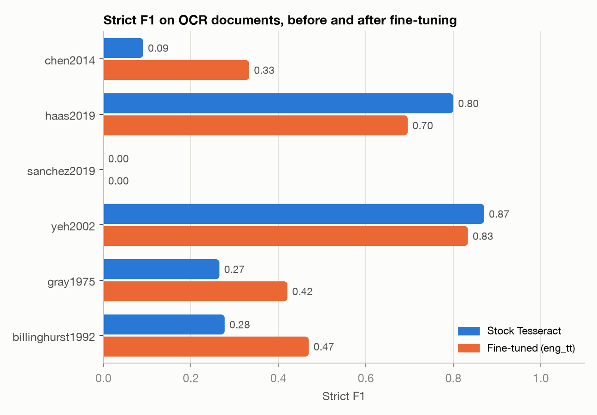

# TableTrace results

Generated by `make eval` from the saved runs in `outputs/runs/`. Do not edit by hand.

Final configuration: **finetuned** (chosen on the calibration split: strict F1 on its OCR documents stock 0.251, finetuned 0.399).

## Corpus

| Document | Type | Route | Split | Labeled values |
|---|---|---|---|---|
| chen2014 | journal article | OCR: rendered pages | test | 18 |
| yao2016 | journal article | Text layer | calibration | 10 |
| tseng2018 | journal article | Text layer | test | 38 |
| zyka2019 | journal article | Text layer | calibration | 67 |
| haas2019 | journal article | OCR: rendered pages | test | 30 |
| rickman2019 | journal article | Text layer | test | 7 |
| sanchez2019 | journal article | OCR: rendered pages | calibration | 15 |
| yeh2002 | patent | OCR: real scans | test | 59 |
| gray1975 | technical report | OCR: real scans | calibration | 194 |
| billinghurst1992 | technical report | OCR: real scans | test | 76 |

514 labeled values in 10 documents.

## Page router

Every page of every document, not only the labeled ones:

| Document route | Pages | Sent to text layer | Sent to OCR | Pages where text inside embedded figures was dropped |
|---|---|---|---|---|
| OCR: rendered pages | 41 | 0 | 41 | 0 |
| Text layer | 56 | 56 | 0 | 24 |
| OCR: real scans | 52 | 0 | 52 | 0 |

## Value extraction

Strict: same sample label, property and value within 1%. Lenient also accepts a sample label with fuzzy similarity of 0.85 or more (an OCR slip in the name) or a value within 5%.

| Split | Labels | Extracted | Precision | Recall | F1 (strict) | F1 (lenient) |
|---|---|---|---|---|---|---|
| Text-layer pages | 122 | 122 | 1.000 | 1.000 | **1.000** | 1.000 |
| OCR pages | 392 | 287 | 0.589 | 0.431 | **0.498** | 0.692 |
| &nbsp;&nbsp;OCR: rendered pages | 63 | 27 | 0.741 | 0.317 | **0.444** | 0.533 |
| &nbsp;&nbsp;OCR: real scans | 329 | 260 | 0.573 | 0.453 | **0.506** | 0.716 |
| All | 514 | 409 | 0.711 | 0.566 | **0.631** | 0.774 |

By split (the review threshold is chosen on calibration papers only):

| Split | Labels | Extracted | Precision | Recall | F1 (strict) | F1 (lenient) |
|---|---|---|---|---|---|---|
| Calibration | 286 | 254 | 0.606 | 0.538 | **0.570** | 0.815 |
| Test | 228 | 155 | 0.884 | 0.601 | **0.715** | 0.715 |

By document:

| Document | Labels | Extracted | Precision | Recall | F1 (strict) | F1 (lenient) |
|---|---|---|---|---|---|---|
| chen2014 (render, test) | 18 | 6 | 0.667 | 0.222 | **0.333** | 0.333 |
| yao2016 (text, calibration) | 10 | 10 | 1.000 | 1.000 | **1.000** | 1.000 |
| tseng2018 (text, test) | 38 | 38 | 1.000 | 1.000 | **1.000** | 1.000 |
| zyka2019 (text, calibration) | 67 | 67 | 1.000 | 1.000 | **1.000** | 1.000 |
| haas2019 (render, test) | 30 | 16 | 1.000 | 0.533 | **0.696** | 0.696 |
| rickman2019 (text, test) | 7 | 7 | 1.000 | 1.000 | **1.000** | 1.000 |
| sanchez2019 (render, calibration) | 15 | 5 | 0.000 | 0.000 | **0.000** | 0.400 |
| yeh2002 (scan, test) | 59 | 49 | 0.918 | 0.763 | **0.833** | 0.833 |
| gray1975 (scan, calibration) | 194 | 172 | 0.448 | 0.397 | **0.421** | 0.760 |
| billinghurst1992 (scan, test) | 76 | 39 | 0.692 | 0.355 | **0.470** | 0.470 |

By property:

| Property | Labels | Extracted | Precision | Recall | F1 (strict) | F1 (lenient) |
|---|---|---|---|---|---|---|
| elongation | 183 | 149 | 0.570 | 0.464 | **0.512** | 0.723 |
| ultimate_strength | 155 | 114 | 0.596 | 0.439 | **0.506** | 0.736 |
| vickers_hardness | 91 | 81 | 0.926 | 0.824 | **0.872** | 0.872 |
| yield_strength | 85 | 65 | 0.969 | 0.741 | **0.840** | 0.840 |

409 values extracted, 91 cells quarantined (non-numeric value: 85, value outside physical range: 6).

## Error analysis

Every missed label (not matched strictly), classified by the stage that lost it.

| Route | Stage | Misses |
|---|---|---|
| OCR: real scans | OCR character error | 119 |
| OCR: real scans | header mapping error | 25 |
| OCR: real scans | unit or number parsing error | 15 |
| OCR: real scans | table structure error | 11 |
| OCR: real scans | table detection | 10 |
| OCR: rendered pages | header mapping error | 22 |
| OCR: rendered pages | unit or number parsing error | 9 |
| OCR: rendered pages | OCR character error | 7 |
| OCR: rendered pages | table structure error | 5 |

## Calibrated review threshold

Learn-then-Test on the calibration papers: the lowest confidence threshold whose accepted set has a one-sided Clopper-Pearson upper bound (delta = 0.1) on its error rate at or below alpha, tested in a fixed sequence from strict to lenient. Values below the threshold go to human review.

| alpha | Threshold | Calibration: accepted / errors / bound | Test: accepted error rate | Test: flagged for review | Test: errors caught by the flag | Guarantee held on all 5/5 paper splits |
|---|---|---|---|---|---|---|
| 5% | 0.970 | 76 / 0 / 3.0% | 0.0% (18 values) | 88.4% | 18 of 18 | 75.6% of 127 |
| 10% | 0.850 | 80 / 3 / 8.2% | 6.2% (65 values) | 58.1% | 14 of 18 | 46.6% of 161 |

Confidence separates correct from incorrect values with AUROC 0.715.

## OCR quality on the image-only papers

OCR text against the original text layer of the same pages (jiwer, geometric reading order on both sides).

| Model | Scope | CER | WER |
|---|---|---|---|
| stock | pages: chen2014 | 4.6% | 10.6% |
| stock | pages: haas2019 | 8.6% | 15.3% |
| stock | pages: sanchez2019 | 8.5% | 13.3% |
| stock | pages: all | 7.5% | 13.2% |
| stock | tables: chen2014 | 9.5% | 29.0% |
| stock | tables: haas2019 | 19.2% | 49.6% |
| stock | tables: sanchez2019 | 43.9% | 64.9% |
| stock | tables: all | 27.9% | 52.0% |
| finetuned | pages: chen2014 | 4.9% | 12.5% |
| finetuned | pages: haas2019 | 8.3% | 14.8% |
| finetuned | pages: sanchez2019 | 7.0% | 12.7% |
| finetuned | pages: all | 6.8% | 13.3% |
| finetuned | tables: chen2014 | 6.0% | 25.8% |
| finetuned | tables: haas2019 | 8.5% | 18.3% |
| finetuned | tables: sanchez2019 | 33.7% | 48.1% |
| finetuned | tables: all | 18.8% | 29.6% |

## Same pages, two routes

The seven journal papers read once through their text layer and once by OCR of the rendered pages.

| Route | Labels | Extracted | Precision | Recall | F1 (strict) | F1 (lenient) |
|---|---|---|---|---|---|---|
| Text layer | 185 | 185 | 1.000 | 1.000 | **1.000** | 1.000 |
| OCR (finetuned) | 185 | 113 | 0.522 | 0.319 | **0.396** | 0.631 |

## Real scans: the vendor OCR layer vs our OCR

Scans from NTRS and Google Patents ship with an OCR text layer. Reading that layer as if it were a text layer is the zero-effort baseline.

| Reading | Labels | Extracted | Precision | Recall | F1 (strict) | F1 (lenient) |
|---|---|---|---|---|---|---|
| Vendor OCR layer | 329 | 109 | 0.532 | 0.176 | **0.265** | 0.338 |
| TableTrace OCR (finetuned) | 329 | 260 | 0.573 | 0.453 | **0.506** | 0.716 |

## Fine-tuning Tesseract

The stock English model has no ± σ ε µ in its character set. `training/` renders 10,000 synthetic lines (random alloy formulas with real subscripts, values with ±, headers, ruled rows, 30% ordinary prose) and continues training tessdata_best/eng on them. Strict F1 per OCR document:

| Document | Split | Stock | Fine-tuned |
|---|---|---|---|
| chen2014 | test | 0.091 | 0.333 |
| haas2019 | test | 0.800 | 0.696 |
| sanchez2019 | calibration | 0.000 | 0.000 |
| yeh2002 | test | 0.870 | 0.833 |
| gray1975 | calibration | 0.265 | 0.421 |
| billinghurst1992 | test | 0.277 | 0.470 |

Values printed with ± recovered with the right uncertainty: stock 27 of 47, fine-tuned 21 of 47.

## Ablation: hidden text in the PDF text layer

The born-digital papers read through their text layer with and without the filter that drops characters clipped inside embedded figures (yao2016: 2,151 hidden characters, tseng2018: 5,402 hidden characters, zyka2019: 1,649 hidden characters).

| Text layer | Labels | Extracted | Precision | Recall | F1 (strict) | F1 (lenient) |
|---|---|---|---|---|---|---|
| With the filter | 122 | 122 | 1.000 | 1.000 | **1.000** | 1.000 |
| Without (the raw text layer) | 122 | 89 | 0.899 | 0.656 | **0.758** | 0.758 |

## First test run and post-hoc fixes

The configuration was frozen before the first run on the test papers; that run is kept in `reports/first_test_run/`. Its errors exposed three defects, fixed afterwards and re-checked on the calibration papers (strict F1 there 0.540 before, 0.570 after):

1. Ruled-header detection read the table's outer border, and the stems of capital letters in a tight header band, as vertical rules, collapsing a boxed header into one cell.
2. Table Transformer sometimes gives two data rows one band (`590 800` in one cell). Rows whose cells hold two lines of numbers are now split along their text lines.
3. Sparse-text OCR drops `±` or isolated short numbers. Such cells are now re-read on their own.

| Strict F1 | First test run | Final |
|---|---|---|
| Test papers | 0.499 | 0.715 |
| OCR pages (all papers) | 0.340 | 0.498 |
| All papers | 0.523 | 0.631 |

## Context: LitXAlloy values

LitXBench (Radical AI, 2026) reports single-property F1 of 0.88 to 0.95 for Gemini 3.1 Pro on its 19 alloy papers, from an OCR transcription that includes the running text. TableTrace reads tables only, so the comparable number is recall of LitXAlloy's values on the 7 papers used here, through the text layer:

| LitXAlloy values | Count | Recovered by TableTrace |
|---|---|---|
| All four properties | 108 | 102 (94.4%) |
| Source cites a table | 74 | 74 (100.0%) |

The values not recovered are the ones LitXAlloy took from the paper text, which a table extractor never sees.

## Failure examples

1. **OCR character error** in chen2014 (Table 3): the cell says `536.6` for `Al1`; sample name read as 'All'.

   

2. **header mapping error** in sanchez2019 (Table 3): the cell says `422 ± 75` for `Al65Cu5Fe5Mg5Si15Zn5`; no yield strength values read from the table.

   

3. **table structure error** in gray1975 (Table 1): the cell says `415` for `Ti-25V`; value attached to '. ar...'.

   

